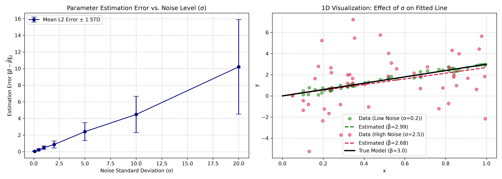

# Linear Regression: Closed-Form OLS & Noise Sensitivity Analysis

Implementation and empirical analysis for **Introduction to Statistical Machine Learning – Problem Set 1**[cite: 4]. This project simulates a synthetic linear regression environment to evaluate the Ordinary Least Squares (OLS) / Maximum Likelihood Estimator (MLE) and analyze how noise variance ($\sigma^2$) affects parameter recovery.

---

## 1. Mathematical Formulation

We model the data generation process as a linear combination of input features plus zero-mean i.i.d. Gaussian noise[cite: 4]:

$$Y = X\beta + \epsilon, \quad \epsilon \sim \mathcal{N}(0, \sigma^2 I)$$

Minimizing the squared error loss $J(\beta) = (X\beta - Y)^\top(X\beta - Y)$ yields the closed-form Normal Equations, which coincide with the Maximum Likelihood Estimator (MLE) under Gaussian noise[cite: 5]:

$$\hat{\beta} = (X^\top X)^{-1} X^\top Y$$

---

## 2. Project Structure

* `linear_regression.py` — Main simulation script generating synthetic data, solving for $\hat{\beta}$, and running Monte Carlo noise sensitivity experiments.
* `sigma_experiment_results.png` — High-resolution visualization of $L_2$ estimation error vs. $\sigma$ and a 1D regression fit comparison.
* `.gitignore` — Excludes local virtual environment (`.venv/`) and Python cache files.

---

## 3. Setup & Reproducibility

To run this experiment locally:

1. **Clone the repository:**
   ```bash
   git clone https://github.com/daniel5320036-design/ml-linear-regression-ps1.git
   cd ml-linear-regression-ps1

## 4. Experimental Results & Conclusions

### 1. Baseline Parameter Recovery ($\sigma = 1.0$, $n = 100$, $m = 3$, `seed=42`)

Using the closed-form Normal Equations (OLS / Maximum Likelihood Estimator), $\hat{\beta} = (X^\top X)^{-1} X^\top Y$, the model accurately recovers the ground-truth weights $\beta$ from noisy observations:

| Metric | Values |
| :--- | :--- |
| **Ground-Truth $\beta$** | `[2.5, -4.0, 1.2]` |
| **Estimated $\hat{\beta}$** | `[2.6125, -4.2959, 1.5921]` |
| **$L_2$ Estimation Error $\|\beta - \hat{\beta}\|_2$** | `0.5039` |

The minor residual discrepancy (`0.5039`) stems from the finite sample size ($n=100$), where the random Gaussian noise realization does not average out to exactly zero.

### 2. Sensitivity to Noise Standard Deviation ($\sigma$)

We conducted a Monte Carlo simulation across increasing values of $\sigma \in \{0.1, 0.5, 1.0, 2.0, 5.0, 10.0, 20.0\}$ (50 trials per noise level):



**Key Takeaways:**
* **Linear Scaling of Estimation Error:** As shown in the left plot, both the mean $L_2$ estimation error $\|\beta - \hat{\beta}\|_2$ and its standard deviation grow linearly with $\sigma$. This empirically confirms the analytical covariance of the OLS estimator, $\text{Cov}(\hat{\beta}) = \sigma^2 (X^\top X)^{-1}$, which dictates that the standard error of $\hat{\beta}$ scales proportionally to $\sigma$.
* **Unbiasedness vs. High Variance:** In the 1D visualization ($m=1$, right plot), low noise ($\sigma = 0.2$) yields observations tightly clustered around the true line ($\hat{\beta} \approx \beta$), whereas high noise ($\sigma = 2.5$) scatters data points and causes substantial slope deviation on a single realization. While the estimator remains theoretically **unbiased** ($\mathbb{E}[\hat{\beta}] = \beta$), high noise variance degrades single-trial accuracy unless compensated by increasing the sample size $n$.   